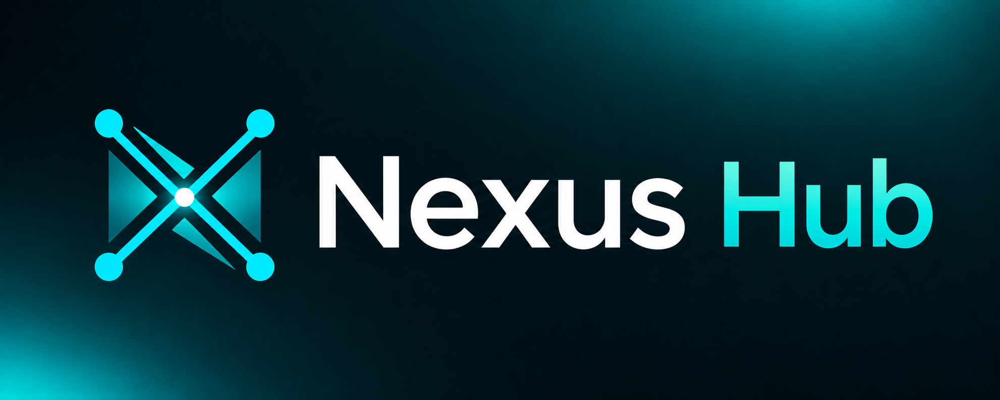
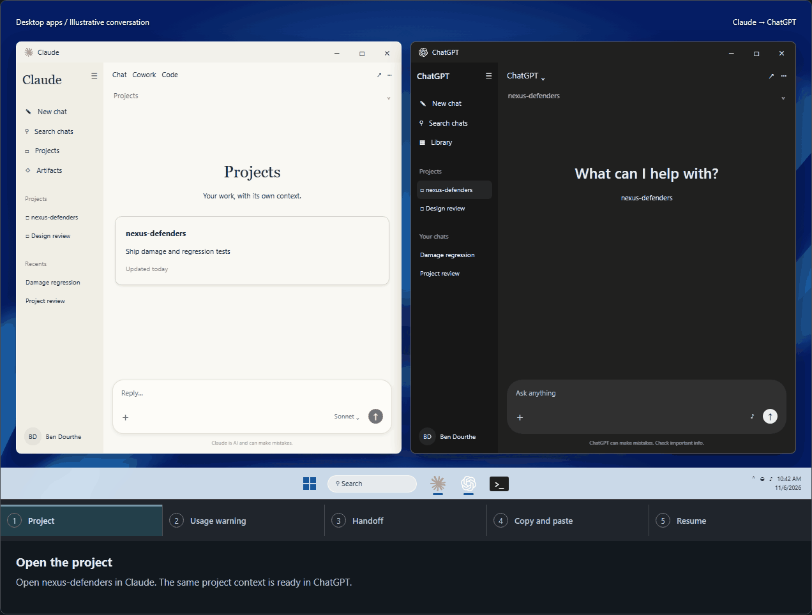
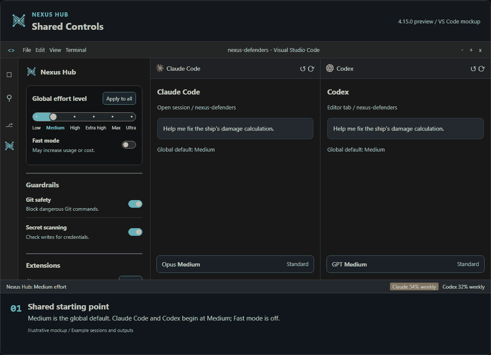
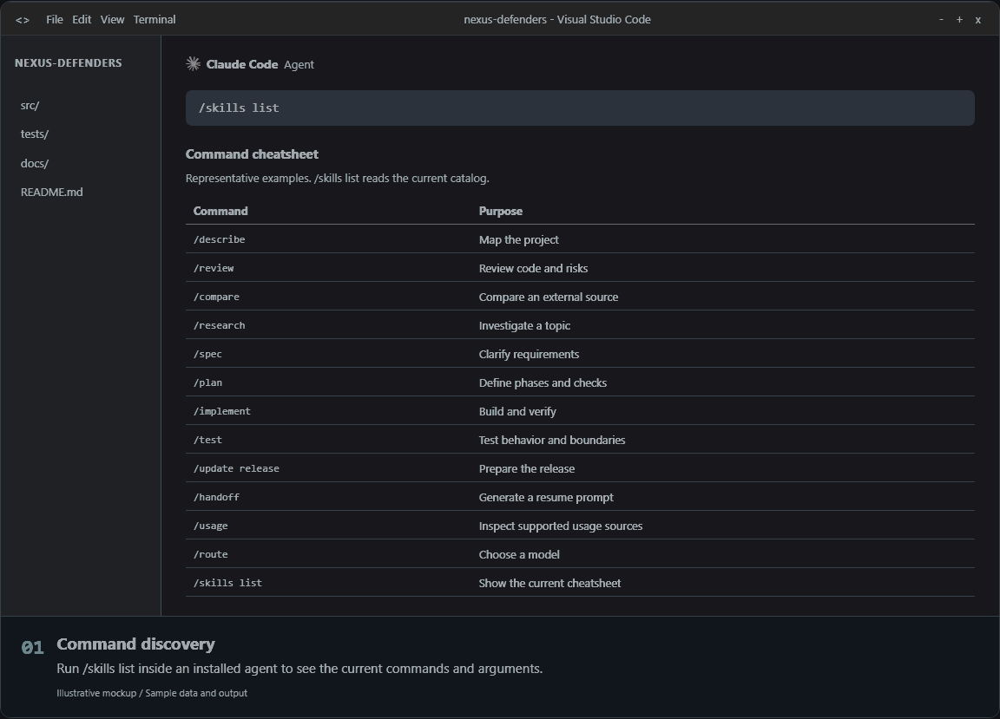
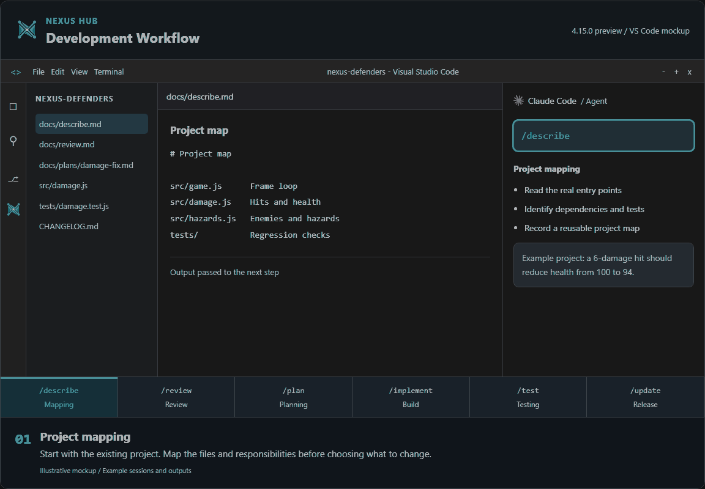
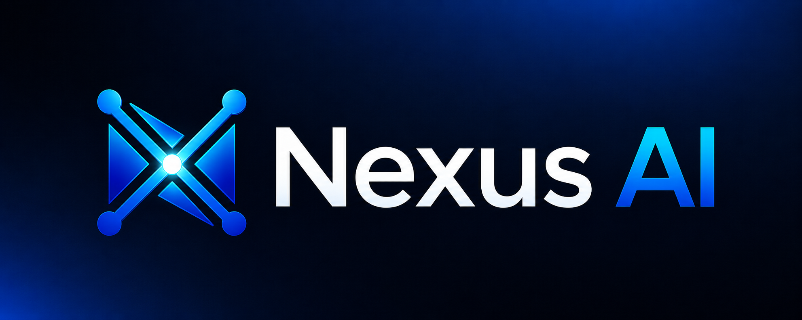

<p align="center"><a href="https://github.com/bendourthe/Nexus-Hub"></a></p>

<p align="center"><em>The Skill Harness for Every AI Coding Assistant.</em></p>

<p align="center"><a href="https://www.benjamindourthe.com/nexus-hub/">Interactive guide</a> | <a href="https://www.benjamindourthe.com/">Author: Benjamin Dourthe</a> | <a href="README_zh.md">Chinese README</a></p>

# Nexus-Hub

<!-- nexus-hub-version: 4.14.8 -->

Nexus-Hub is the upstream skill catalog for AI coding assistants: 340 skills across 23 categories, 21 commands (plus 3 permanent aliases), 37 registered hooks, 23 agents, and 4 language rule families plus the HTML artifact rules. It installs in one step on Windows, macOS, and Linux, through 17 platform integrations: Claude Code, OpenAI Codex, Gemini and Antigravity, GitHub Copilot, Cursor, OpenCode, Qwen Code, Kimi Code CLI, Devin Desktop / Windsurf, Hermes, Pi, OpenClaw, Aider, and the sibling Nexus desktop app. The catalog is reverse-engineering-first by policy. Account usage checks are limited to each tool's own provider; the catalog has no third-party data processors or telemetry.

## Interactive Guide -- start here

**New to Nexus-Hub? [Open the interactive guide online](https://www.benjamindourthe.com/nexus-hub/)**, or open [the copy in this repository](guides/website/nexus-hub-guide.html). It is two self-contained, offline HTML pages: the guide (a concise Home with the install commands, eight Foundations scenes that build a practical mental model from tokens through harnesses, and one Cheatsheets tab for the loop plus command arguments) and its Training page, a guided live demo that fixes a buggy arcade game in one pass of the six-command Development Workflow, then hands over the fixed game. It is the fastest way to get a teammate productive, and it doubles as a live-demo-quality workshop.

- **Files:** [`guides/website/nexus-hub-guide.html`](guides/website/nexus-hub-guide.html) and [`guides/website/training.html`](guides/website/training.html) -- fully offline, no server or install required.
- **Online:** [benjamindourthe.com/nexus-hub](https://www.benjamindourthe.com/nexus-hub/) serves the published guide and its Training page.
- **To view it:** GitHub does not render HTML inline. Clone the repo and double-click `nexus-hub-guide.html`, or download both pages and the `assets/` folder beside them and open the guide in any browser.
- **To share it:** send both pages together with the `assets/` folder beside them. If `training.html` is missing, the guide's Training links show a notice instead of a browser error. See [guides/website/README.md](guides/website/README.md) for maintainer notes.

> **Renamed from DevAI-Hub at v2.0.0** to align with the sibling project [Nexus](https://github.com/bendourthe/Nexus-AI), a local-first desktop AI Studio that consumes Nexus-Hub as its upstream skill feed. Existing `~/.devai-hub/` installs are migrated in place by the v2.0.0 installer on first run; see [docs/archives/v2/v2.0/RELEASE_NOTES.md](docs/archives/v2/v2.0/RELEASE_NOTES.md) for the full migration story.

---

## Nexus Hub Across Platforms

Think of Nexus Hub as a shared knowledge layer: hundreds of multidisciplinary skills, reusable workflows, guardrails, rules, and best practices. Installed integrations bring that foundation into IDE agents. Project artifacts and explicit handoffs let you change providers, models, IDEs, or apps while keeping the goal, decisions, constraints, and next step clear.



[Static overview](assets/readme/nexus-hub-continuity.png) | [Editable offline handoff walkthrough](guides/website/readme-demos.html#continuity)

### Handoff Across Tools

1. **Stop at a safe point.** Run `/handoff` in an installed integration, optionally with a focus such as `/handoff focus on the damage regression`. The default result is a paste-ready prompt in chat; it does not create a file.

2. **Carry the working context.** Copy the prompt into the receiving agent or chat. Open the same project in another IDE, or provide the relevant files and Nexus Hub guidance to a desktop chat.

3. **Resume from evidence.** The receiving IDE agent checks the current branch, files, completed work, remaining tasks, and acceptance criteria before continuing. Desktop chats can review and plan from the context you supply; return their conclusions to an agent with project access for execution and verification.

VS Code, Cursor, and Antigravity use their installed integrations. The Claude and ChatGPT desktop mockups show user-provided context, not an installed Nexus Hub settings panel or automatic hook enforcement. Conversation history, files, and permissions do not synchronize automatically. For the complete prompt contract, see [handoff](catalog/commands/handoff.md).

## Shared IDE Controls

**Planned for v4.15.0:** the upgraded Nexus Hub extension brings shared effort, Fast mode, guardrails, usage alerts, and extension controls into one panel in VS Code, Cursor, and Antigravity. These IDE mockups and simplified desktop views illustrate the behavior; example sessions and outputs are not recordings of an agent run.



[Static image](assets/readme/nexus-hub-settings.png) | [Editable offline preview](guides/website/readme-demos.html#settings)


- **One default, with session choices.** Changing global effort updates supported open sessions and the default for new ones. A manual change stays local to that session until the next global change or **Apply to all**.

- **Speed and protections.** Fast mode is separate from reasoning effort and may increase usage or cost. Its toggle is disabled where unsupported. Enabled guardrails act on the next supported hook event.

- **Quiet monitoring.** Turn usage alerts off together or per provider; taskbar colors and monitoring remain active. VS Code shows Claude Code, Codex, and Copilot choices. Cursor and Antigravity each show one master toggle for their own monitor.

- **Provider controls where they belong.** VS Code groups Claude Code and Codex recovery controls by extension. Codex tabs include History and Refresh. Cursor and Antigravity omit these VS Code extension controls.

## Command Cheatsheet

Run [`/skills list`](catalog/commands/skills.md) for the current catalog, command arguments, aliases, and common workflows. This visual quick reference shows representative commands for understanding a project, building a change, and continuing elsewhere; the command files remain the source of truth.



[Static quick reference](assets/readme/nexus-hub-commands.png) | [Editable offline command walkthrough](guides/website/readme-demos.html#commands)

The examples use an installed agent's command or skill surface. In a plain desktop chat, provide the relevant guidance and ask in natural language rather than assuming Nexus Hub slash commands are installed.

## Development Workflow

The [interactive guide](guides/website/nexus-hub-guide.html) teaches a six-command loop. This mockup follows its example game: a small hit should reduce health, not destroy the ship. Each step leaves an artifact the next step can use.



[Static image](assets/readme/nexus-hub-workflow.png) | [Editable offline preview and text walkthrough](guides/website/readme-demos.html#workflow)

| Step | Purpose | Output |
|---|---|---|
| `/describe` | Understand the existing project | Project map |
| `/review` | Find and prioritize defects | Findings with evidence |
| `/plan` | Define scope and verification | Phases and acceptance criteria |
| `/implement` | Build and verify each phase | Changes and local commits |
| `/test` | Exercise failures and boundaries | Regression tests and observed behavior |
| `/update release` | Synchronize release artifacts | Version and release documentation |

Merge, tagging, and publication follow the project's release gates and authorization. For the full exercise, open [Training](guides/website/training.html). To play either preview locally, clone or download the repository and open `guides/website/readme-demos.html`; playback is opt-in, and every scene has a text walkthrough.

## How Nexus-Hub fits with Nexus

<p align="center">
<a href="https://github.com/bendourthe/Nexus-Hub"></a>

<a href="https://github.com/bendourthe/Nexus-AI"></a>
</p>

Nexus-Hub and [Nexus](https://github.com/bendourthe/Nexus-AI) are two halves of the same idea, split along a deliberate seam.

- **Nexus-Hub (this repo)** is the catalog: 340 curated skills, 21 commands, 37 registered hooks, 23 agents, 5 rule families (4 languages plus HTML), plus 4 internal MCP servers (`nexus-skill-server`, `nexus-code-search`, `nexus-web-fetch`, `nexus-context-compressor`) and the local `nexus-memory` CLI store. It is content-only, platform-agnostic, and shipped via an installer that writes to `~/.nexus-hub/` and into each AI assistant's per-platform config locations.
- **Nexus** is a local-first desktop AI Studio that consumes Nexus-Hub as its skill feed. Nexus's `AGENTS.md` names this repo as "the only external project we deliberately link to" -- the upstream feed for its skill harness.

The two projects are designed to be useful independently: you can install Nexus-Hub into any supported agent platform without touching Nexus, and Nexus can run with or without the upstream catalog wired in. The combination is what gives a single curated skill set to every agent surface a developer touches: terminal, IDE, desktop app, and CLI.

---

## What's New in v4.14.8

**Plain English, and you can tell what Nexus-Hub said.** Agents are asked to write in simple English that a non-native reader can follow, to quote warnings and errors exactly, and to avoid agent and engineering slang; `anti-slop-editing` lists the slang with plain replacements. Every Nexus-Hub hook and helper message now starts with `[Nexus-Hub: <hook-name>]`, so a Nexus-Hub block or warning is never mistaken for a message from the tool itself.

**Settings at a glance.** The Nexus-Hub Settings extension adds a status-bar entry beside the usage monitors: the Nexus-Hub mark, the effort a new session starts with, and a warning count when a default does not apply. Hover for every tool's defaults; click for the redesigned panel. See [the status bar](guides/NEXUS_HUB_SETTINGS.md#status-bar).

**Usage-limit answers stick, and handoffs move on.** Answers to a usage-limit question are saved directly, with `nexus-hub usage status` and `nexus-hub usage decide` to recover, and a handoff no longer tells the next platform to wait for the previous one's limit to reset.

See [the changelog](CHANGELOG.md#4148---2026-11-04) for all changes and capability usage instructions.

Earlier release notes are in the [changelog](CHANGELOG.md).

## Supported Agentic Platforms

| Platform | Install target | Path | Per-platform surface |
|---|---|---|---|
| Claude Code (Anthropic) | `~/.claude/` + project `.claude/` | legacy + registry | Full: skills, commands, hooks, agents, rules, MCP configs |
| OpenAI Codex CLI | `~/.codex/` + project `.codex/` + `AGENTS.md` | registry | Full: skills (under `skills/`), commands (under `prompts/`), agents, rules |
| Gemini (IDE / Antigravity 1.0) | `~/.gemini/` + project `.gemini/GEMINI.md` | registry | Full: skills, commands (under `workflows/`), agents, rules |
| **Gemini CLI (Google, ENTERPRISE-ONLY post-2026-06-18)** | `~/.gemini/commands/*.toml` + project `.gemini/commands/*.toml` | **registry (new in v2.1.0; gated behind `--enterprise` / `-Enterprise` flag in v2.2.0)** | TOML-format custom commands generated from `catalog/commands/*.md`. Non-enterprise users transition to Antigravity CLI before 2026-06-18 per the 2026-05-21 Google announcement. |
| **Antigravity 2.0 + CLI (Google)** | `~/.gemini/antigravity-cli/` + project `.agents/` | **registry (new in v2.1.0, CLI coverage added v2.2.0; paths verified v2.3.0)** | Full: skills, commands (under `workflows/`), subagents, rules. Single integration covers both the desktop IDE and the standalone Antigravity CLI (`agy` binary), verified 2026-05-29 against Google's public Antigravity CLI docs. |
| GitHub Copilot (VS Code) | project `.github/copilot-instructions.md` + VS Code user-profile `prompts/` | registry | Personal and repository instructions (skill index embedded as text), native agents and hooks, user-global `/<name>` prompts; opt-in `.github/skills/` wrappers via `NEXUS_HUB_COPILOT_SKILLS` |
| Cursor | project `.cursor/` + `AGENTS.md` | registry | Flattened skills (one command-skill per catalog command), `.cursor/rules/nexus-hub.mdc`, and the `AGENTS.md` guardrails |
| OpenCode | `~/.config/opencode/` + project `.opencode/` + `AGENTS.md` | registry | Skills, commands, rules, and agents |
| Qwen Code | `~/.qwen/` (detection-gated) + project `.qwen/` | registry | Flattened skills, subagents, Markdown commands, and `QWEN.md` |
| Kimi Code CLI | `~/.kimi-code/` (detection-gated) + project `.kimi-code/` | registry | Flattened skills (each surfaces as `/skill:<name>`) and `AGENTS.md` |
| Devin Desktop / Windsurf | `~/.codeium/windsurf/` + project `.devin/` and `.windsurf/` | registry | Native skills, workflows, rules, and hooks; `.windsurfrules` kept for compatibility |
| Hermes | `~/.hermes/skills/` (detection-gated) + project `.hermes/skills/` | registry | Native folder-per-skill `SKILL.md` discovery; no instruction file needed |
| Pi | `~/.pi/agent/` (detection-gated) + project `.pi/` | registry | Flattened skills plus one prompt template per command (Pi's `/name` surface) |
| OpenClaw | the configured OpenClaw workspace | registry | `AGENTS.md`, `SOUL.md`, `IDENTITY.md`, and native skills; no tool-interception hooks |
| Aider | project `CONVENTIONS.md` | registry | Behavioral guardrails only; a global install is a no-op |
| **Nexus-AI (Local Studio)** | `~/.nexus-ai/catalog/` + project `.nexus-ai/catalog/` | **registry (new in v2.1.0)** | Full mirror: skills, commands, agents, rules, hooks, MCP configs, templates, plus a `nexus-hub-version.json` manifest. Isolated under `catalog/` so the app's own data at the `~/.nexus-ai/` root stays outside a catalog refresh. |
| GitHub CLI (`gh`) | via `gh copilot` extension | indirect | Skill / command references via `AGENTS.md` open standard |
| Nexus desktop app | upstream consumer | indirect | Reads the same catalog as its skill feed |
| Nexus VS Code extension | upstream consumer | indirect | Reads the same catalog as its skill feed |

**Coverage caveat**: every platform now installs through the **registry** path, which dispatches install / teardown through `scripts/lib/integrations/runner.py` and supports a `--dry-run` mode. For Claude Code, the one row marked "legacy + registry", the registry renders only the marker-merged instruction file while the installer's own copy blocks write the catalog tree. Coverage differs surface by surface, and the authoritative per-platform read paths and coverage tiers are in [`docs/policy/platform-read-contracts.md`](docs/policy/platform-read-contracts.md). The per-platform installer logic lives in [`scripts/installer.sh`](scripts/installer.sh), [`scripts/installer.ps1`](scripts/installer.ps1), and the per-platform subclasses under [`scripts/lib/integrations/`](scripts/lib/integrations/). Per-platform capability specs (install surface, distributed content, instruction file, quirks) are documented under [`docs/specs/`](docs/specs/).

**Branch-based install** (v2.4.0): pass `--branch <name>` (Bash) or `-Branch <name>` (PowerShell) to install the catalog from a pushed branch instead of the current checkout. The installer shallow-clones the repo at `<name>` into a deterministic cache directory (`~/.nexus-hub/branches/<sanitized-name>/`) and runs the install from that checkout, so the user's working copy is never touched. The branch name is sanitized for filesystem safety (path-traversal sequences are neutralized). Combine with `--check` / `-Check` for a clone-free probe that prints the resolved cache path and clone source.

---

## Quick Start (one command)

Open a terminal and paste the line for your system. It downloads the catalog from this repo and runs the installer -- no clone, no unzip, no `cd`.

**macOS / Linux** (paste into Terminal):

```bash
curl -fsSL https://raw.githubusercontent.com/bendourthe/Nexus-Hub/main/install.sh | bash
```

No `curl` on the box? Use `wget`:

```bash
wget -qO- https://raw.githubusercontent.com/bendourthe/Nexus-Hub/main/install.sh | bash
```

**Windows** (paste into PowerShell):

```powershell
irm https://raw.githubusercontent.com/bendourthe/Nexus-Hub/main/install.ps1 | iex
```

That is the whole setup -- no prompts. The installer prechecks its dependencies (and tells you exactly what to install if one is missing), then performs a global install across every supported assistant it detects; assistants you do not have are skipped with a note, never an error. For Kimi Code CLI, Qwen Code, Hermes, Pi, Aider, OpenCode, and Nexus AI Studio, "have" means the installer found the tool itself (its command on `PATH`, files the tool wrote, or its application), not a folder an earlier Nexus-Hub install created; the skip note says what it looked for, and `nexus-hub doctor` lists leftover Nexus-Hub files for tools you do not have, which `nexus-hub prune-undetected` removes (preview first, `--yes` to delete). See `docs/policy/platform-detection.md`. Your customizations are preserved (marker-merge), and on a re-install it asks once only if it finds a managed file you changed that it would overwrite, naming the file.

**Done.** The installer writes to `~/.nexus-hub/` (the user-global catalog) and into each supported assistant's per-platform config locations. If a legacy `~/.devai-hub/` install is detected, you will see a single migration prompt at the top of the run -- answer `Y` (default) to migrate in place.

After the installer completes:

- **Globally**: your user profile has all 340 skills, 21 commands, 37 registered hooks, 23 agents, plus Gemini and Codex instructions.
- **Locally**: your project has `copilot-instructions.md` and `AGENTS.md` tailored to your language.

**Power-user flags**: `--workspace <path>` installs into a single repo instead of globally; `--platforms <comma-list>` limits the install to a subset of assistants, and naming one that the installer did not find (for example `--platforms qwen`) installs it anyway; `--yes` runs fully unattended (refreshes managed files with no prompt -- ideal for CI). Prefer to clone first? `git clone` the repo and run `./install.sh` (macOS / Linux) or `install.bat` (Windows) -- the in-repo path still works exactly as before.

### Claude Code plugin (subscribe-style alternative)

The installer above is the primary path: every platform, hooks, and `nexus-hub upgrade`. Claude Code users who only want the catalog as a plugin can subscribe instead:

```
/plugin marketplace add bendourthe/Nexus-Hub
/plugin install nexus-hub@nexus-hub
```

This is not a replacement for the installer. It does not install hooks, other platforms, or the `nexus-hub` CLI.

If Anthropic later lists Nexus-Hub in `claude-plugins-official`, that listing is pinned to a git SHA that can lag tagged releases. Marketplace users may trail `main`. Prefer the installer, or this repo's marketplace added from a release tag, when you need the current release. The maintainer submission draft is [`docs/archives/v3/v3.20/development/claude-marketplace-submission.md`](docs/archives/v3/v3.20/development/claude-marketplace-submission.md).

### Installing a subset (selective installation)

By default you get the whole catalog. If you want a smaller install, pick a **profile**, one or more **capability modules**, or one or more **role bundles**. Selectors combine by union.

```bash
# macOS / Linux
bash scripts/installer.sh --profile core
bash scripts/installer.sh --modules ai-engineering,testing
bash scripts/installer.sh --bundles ai-engineer
bash scripts/installer.sh --profile core --modules security-operations   # union
```

```powershell
# Windows
.\scripts\installer.ps1 -Profile core
.\scripts\installer.ps1 -Modules ai-engineering,testing
.\scripts\installer.ps1 -Bundles ai-engineer
```

Profiles are `minimal`, `core`, and `full`. Modules group skills by capability (one per catalog category, so every skill is reachable through at least one). Role bundles are curated cross-category sets like `ai-engineer` or `devops-engineer`. List what is available with `python scripts/lib/installer/selection.py --repo-root . --profile core` , which prints the resolved plan without installing anything.

Three things worth knowing before you narrow an install:

- **Hooks, rules, templates, and settings always install**, under every selection including `minimal`. Narrowing your skill set asks for fewer capabilities, never for fewer guardrails.
- **Commands and agents follow their skills.** A command that is a thin pointer over one skill (for example `/implement` over `implement-phase`) installs only when that skill is selected; everything else installs regardless. So a focused install stays coherent instead of leaving commands that cannot do anything.
- **No selector means the full catalog**, byte-for-byte identical to what you would have got before selective installation existed.

`nexus-hub upgrade` re-applies whatever you selected, so an upgrade never quietly widens a focused install back to everything. To change scope, pass a new selector; to go back to everything, pass `--profile full`.

Selectors need Python to resolve. A full install does not.

### Check the installed version

```bash
nexus-hub version    # prints the installed version
nexus-hub upgrade    # checks for the latest release and updates in place
```

`nexus-hub -v` and `nexus-hub --version` print the same line as `nexus-hub version`.

### Keeping it current

Run `nexus-hub upgrade` -- it reports your installed version against the latest, shows a short what's-new summary, and updates in place on confirmation. Re-running the install command above works too; the installer is idempotent.

### Pinning a version, verifying the download, rolling back

The one-line install above follows the `main` branch, which has no publishable checksum because every commit changes the archive. To install a specific release instead, pin a tag; a pinned install downloads the tarball the project published for that release and verifies it before anything runs.

| Element | Detail |
|---|---|
| **Activation** | macOS / Linux: `curl -fsSL https://raw.githubusercontent.com/bendourthe/Nexus-Hub/main/install.sh \| bash -s -- --ref v4.7.0`. Windows: `&([scriptblock]::Create((irm https://raw.githubusercontent.com/bendourthe/Nexus-Hub/main/install.ps1))) -Ref v4.7.0`. The `NEXUS_HUB_REF` environment variable does the same. |
| **Validation** | The bootstrap prints `checksum OK (<sha256>)` before extracting; `nexus-hub --version` reports the installed version; `~/.nexus-hub/PINNED_REF` holds the pinned tag. `gh attestation verify Nexus-Hub-4.7.0.tar.gz -R bendourthe/Nexus-Hub` checks the build-provenance attestation of the published tarball. |
| **Rollback** | `nexus-hub upgrade --ref v4.6.0` installs an older tag (any tag that carries the published artifact set, v4.7.0 and later); `nexus-hub upgrade --latest` moves a pinned install to the newest release; installing `main` again removes the pin. |
| **Authority** | Verification proves the download is byte-for-byte what the release workflow published for that tag. It does not audit the catalog's content, grant any platform permission, or protect the host; a pinned install receives no updates until you move it. Tags published before v4.7.0 carry no artifact set and fail closed. |
| **Docs** | `docs/decisions/implemented/policy/2026-09-05-verifiable-pinnable-installs.md`; the bootstrap headers in `install.sh` and `install.ps1`. |

`nexus-hub upgrade` on a pinned install refuses to move and prints those options, so an upgrade never quietly unpins you.

### Verifying your install

Run `nexus-hub verify` to confirm your installed catalog matches the published release. It recomputes the SHA-256 of every file in the catalog tree and diffs the result against the `MANIFEST.sha256` that ships with each release, reporting any file that is modified, missing, or unexpected, then a single `verify: PASS` or `verify: FAIL` line. It is strictly local: it reads only local files, makes no network call, needs no credential, and adds no dependency.

What this does and does not prove: `verify` detects on-disk tampering or corruption AFTER install, relative to the published catalog. It is trustworthy to the extent the manifest itself came from the release you trust (it rides inside the same signed release tag the installer pulls from). It is NOT a code signature and NOT a substitute for verifying the download channel -- an attacker who can rewrite both a file and the manifest in the same tree defeats it. Use it to catch accidental corruption and post-install drift, not to establish first-trust in the bytes.

### Add organization standards

Connect a validated local-directory or Git bundle with `nexus-hub org connect <path-or-url>`, inspect it with `nexus-hub org status`, and then reinstall or repair the target workspace. Nexus-Hub projects the organization's concise core and rule files into existing platform surfaces without uploading the bundle or claiming policy enforcement. See the [Organization Knowledge Layer guide](guides/ORG_KNOWLEDGE_LAYER.md) for the bundle contract, lifecycle commands, precedence model, authoring workflow, and rollback procedure.

---

## What is Nexus-Hub?

Most AI assistants are generic by default: they know a lot but specialize in nothing. Nexus-Hub is the layer that turns a generic assistant into a specialist for the work you actually do.

It does three things:

1. **Behavioral rules** -- per-language code-style and security rules that tell the assistant how to write code in your project (not just whether the code compiles).
2. **Autonomous skills** -- 340 curated capability prompts grouped into 23 categories. Each skill has a 3-tier loading model (always-loaded summary, body on trigger, deeper references on demand) so context cost stays proportional to what the agent actually needs.
3. **Workflow awareness** -- 21 slash commands (plus 3 permanent aliases) that chain skills into multi-step processes (plan generation, phase implementation, deep review, version bump, release notes, session history).

The catalog itself is content; the harness around it is the per-platform installer plus a small set of local MCP servers that surface the catalog to any agent that speaks MCP.

---

## Recommended Workflows

Nexus-Hub provides two opinionated end-to-end workflows. Use these as a starting point and adapt to your project.

### New Project Workflow (5 phases)

Build from scratch with an AI coding agent as your primary partner.

#### 1. Planning

Open an AI chatbot (Claude.ai or ChatGPT) and brainstorm: problem, users, core features, tech stack, constraints. End the session by asking the chatbot to produce a structured Markdown implementation plan -- phases with subtasks, each subtask carrying a self-contained prompt the agent can execute.

#### 2. Project setup

1. Create the Git repo with a three-tier branching model: `main` / `develop` / `feature/*`.
2. Install the Nexus-Hub toolkit -- paste the one-line install command for your OS (see [Quick Start](#quick-start-one-command)).
3. In Claude Code, run `/setup project` -- bootstraps `CLAUDE.md`, the directory structure, `.gitignore`, `README.md`, `DEVLOG.md`, and `CHANGELOG.md` in 8 guided phases.
4. Save the implementation plan from step 1 to `docs/releases/v<MAJOR>/v<MAJOR>.<MINOR>/plans/v<version>-<slug>.md`.
5. Commit with `/commit`.

#### 3. Development (core loop)

Run `/implement <slug>` once. It asks every approval the run needs in one upfront round, then runs the whole plan in its own worktree: every subtask of every phase, tests and fixes, `/update gitignore` + `/update docs`, a session-history file, and a local commit per phase, then the single publication, the release, and cleanup. It stops only when the completion checker reports a terminal verdict, on a named blocker, or when you run `/implement pause`; `/implement <slug>` resumes.

To work one phase at a time instead, run `/implement <slug> phase <N>` (or `next`) in a fresh session per phase, or `/implement <slug> phase-by-phase` to review and commit after each phase.

**Non-final phases do not push** (v4.0.0). A remote pipeline run per phase bills to validate work the plan itself calls incomplete, and a red check on incomplete work teaches you to stop reading red checks. One branch, one commit per phase, all local.

The final phase does the rest in order: it reconciles your pipeline against the canonical CI/CD contract via `[[cicd-architect]]`, completes the full local gate, then pushes ONCE with your explicit approval and opens the integration pull request. That pull request is the plan's first remote validation, and it tests the merge result rather than the branch tip. A red required check reopens the final phase and is reproduced locally before any re-push; release work starts only after the merge lands green.

If you do want to push mid-plan (to share work in progress, say), just ask -- the rule removes the default, not your authority.

Each `/implement` phase runs a best-effort model-routing pre-flight before building: it re-confirms the model and reasoning effort `/plan` recorded for the phase, re-assessing against the currently-available models so a plan built before a new release picks up the newer or cheaper option. It is platform-agnostic and never blocks (it degrades to the plan's recommendation when routing is unavailable). Run `/route` to route any task or phase on demand.

#### 4. Quality assurance (pre-release)

1. Run `/review full` -- a 12-phase orchestrator that chains known-gaps collection, health gates, dependency scan, docs / git hygiene, project validators, codebase description (`/describe full`), and the `security`, `pentest`, and full codebase-review scopes.
2. Read the synthesis report -- it produces a P0 / P1 / P2 / P3 ranked list of findings with a GO / GO-WITH-CONDITIONS / NO-GO verdict.
3. Address all P0 and P1 findings before release. P2 findings can be deferred to a follow-up patch release; P3 findings are advisory.
4. Run `/review sbom` for compliance documentation.

#### 5. Release

1. Run `/update release` -- orchestrates version detection, layout cleanup, `.gitignore` audit, version-bump across all configuration files, CHANGELOG migration, doc sync, and the DEVLOG index line.
2. Merge `develop` into `main`, tag the release, and push.

### Inherited Project Workflow (2 phases)

For projects you have inherited or need to audit.

#### 1. Primary analysis and deep review

1. Clone the repo, open it in VS Code, start a Claude Code session.
2. Run `/review full` -- the same 12-phase orchestrator from Phase 4 of the New Project Workflow. The synthesis report's prioritized roadmap (P0 / P1 / P2 / P3) becomes your initial backlog.
3. If documentation is sparse, backfill it: `/update docs` (README, if missing), `/update changelog` (from git history), `/update devlog`, `/update refactor` (only when the repo has structural issues).
4. Establish the `develop` branch if not already present.
5. Commit the analysis artifacts.

#### 2. Making changes

For each change:

1. Brainstorm in a chatbot, then run `/plan` to produce a structured implementation plan saved to `docs/releases/v<MAJOR>/v<MAJOR>.<MINOR>/plans/v<version>-<slug>.md`.
2. Run `/implement <slug>` to run the whole plan, or `/implement <slug> phase <N>` per phase -- identical to the New Project Workflow's development loop.
3. (Optional) Use git worktrees for parallel work:

    ```bash
    git worktree add ../project-fix feature/security-fix
    # work in a separate Claude Code session, then:
    git worktree remove ../project-fix
    ```

4. After all changes land on `develop`, run `/review full` again to verify nothing regressed, then `/update release` and merge to `main`.

The QA and release steps are identical to the New Project Workflow.

---

## Manual setup (if you do not want to run the installer)

If you prefer to copy things yourself, here is how the repo is organized.

### Claude Code (Anthropic)

The most powerful integration -- adds **autonomous agent capabilities**.

- **CLAUDE.md**: the "brain". Copy `templates/ai-instructions/base-claude.md` to `CLAUDE.md` at your project root and customize.
- **Skills**: the "hands". Copy folders from `catalog/skills/` to your project's `.claude/skills/` folder.

    *Example*: copy `catalog/skills/research/trend-research` to enable the trend-research skill.

### Gemini (Google) and Antigravity

Optimized instructions for Google's Gemini models, including the Antigravity workspace layout.

- **Gemini instructions**: copy `templates/ai-instructions/base-gemini.md` (or `templates/ai-instructions/generic-instructions.md` for the legacy template) to `.gemini/GEMINI.md` in your project or user profile.
- **Skills and workflows**: the installer mirrors these to `.gemini/skills/` and `.gemini/workflows/`; Antigravity 2.0 receives its own copies under `~/.gemini/config/skills/` and `~/.gemini/config/workflows/`.

### GitHub Copilot (Microsoft)

Instructions for VS Code's Copilot Chat.

- Copy `templates/ai-instructions/coding-instructions/{language}.md` to `.github/copilot-instructions.md`.

### Codex (OpenAI)

OpenAI Codex CLI integration. Codex reads `AGENTS.md` at the project root (the open standard, also honored by Cursor / Aider / Jules) plus its user-level config in `~/.codex/`.

- **AGENTS.md**: copy `templates/ai-instructions/base-codex.md` content into your project's `AGENTS.md`.
- **Skills and prompts**: the installer mirrors `catalog/skills/` to `~/.codex/skills/` and `catalog/commands/` to `~/.codex/prompts/`. For manual setup, copy each tree to those destinations.

### Cursor

Cursor IDE integration.

- **Project rules**: copy `templates/ai-instructions/base-cursor.md` content into `.cursor/rules/nexus-hub.mdc` at your project root. Use `alwaysApply: true` in the frontmatter so Cursor applies the rule on every prompt.
- **Open-standard `AGENTS.md`**: Cursor also reads `AGENTS.md` at the project root, so the Codex setup above covers Cursor too.

### OpenCode

OpenCode IDE integration. OpenCode reads `AGENTS.md` per the open standard.

- Copy `templates/ai-instructions/base-opencode.md` content into your project's `AGENTS.md`.

---

## Development setup

For contributors working *on* Nexus-Hub (not consumers of the installer), the repo ships a [`.devcontainer/`](.devcontainer/) at the root. Open the repo in VS Code with the Dev Containers extension installed (or click "Reopen in Container" when prompted) and the post-create hook will install Python tooling (`pytest`, `ruff`), the GitHub CLI (`gh`), and the Claude Code CLI (`claude`). Authenticate `gh` and `claude` once the container is up, then run `make validate` to confirm the catalog is clean.

The devcontainer is opt-in -- the standard Quick Start above does not require it. It exists for first-touch contributor onboarding and for reproducing the maintainer's environment across machines.

Maintainers can opt into the [repository attribution hook](.githooks/README.md). The normal validation profile also checks full Git history; use a complete clone. This repository-specific policy is not distributed by the installers.

### Running the checks locally

Validation logic lives in the repository, not in the workflow files, so what CI runs is exactly what you can run:

Before running `make test` on a fresh clone, run `make dev` to install all six extension development extras. On a Windows host without `make`, run the same install directly:

```powershell
python -m pip install --quiet -e "extensions/nexus-skill-server/[dev]" -e "extensions/nexus-code-search/[dev]" -e "extensions/nexus-web-fetch/[dev]" -e "extensions/nexus-skill-scanner/[dev]" -e "extensions/nexus-context-compressor/[dev]" -e "extensions/nexus-memory/[dev]"
```

```bash
make ci-fast       # seconds: parses, hygiene, workflow security, version sync
make ci-full       # minutes: every validator, the whole test tree, extensions
make ci-platform   # shell lint, PowerShell AST parse, Windows PowerShell 5.1 legs
```

Each target is a one-line delegation to `python scripts/ci/run.py --profile <name>`, which needs no CI provider and no network. Add `--list` to print what a profile would run without running it, or `--base origin/develop` to scope the run to what changed. Reports land in `reports/` (gitignored): a readable `summary.md`, plus JUnit, `summary.json`, and environment metadata.

Full guide, including how to add a check: [`docs/guides/repository-native-ci-profiles.md`](docs/guides/repository-native-ci-profiles.md).

---

## Featured Skills

| Skill | What it does |
|-------|--------------|
| **Architecture Design** | System decomposition, ADRs, C4 diagrams, and fitness functions. |
| **AI Agent Development** | Build agents with tool use, memory systems, and multi-agent orchestration. |
| **RAG Implementation** | End-to-end RAG pipelines with chunking, embeddings, and evaluation. |
| **API Design** | REST, GraphQL, and gRPC design with versioning and error handling. |
| **Code Review** | A 6-step deep dive (security, performance, logic) before you merge. |
| **Test Gen** | Writes comprehensive unit tests using AAA pattern and mocks. |
| **E2E Testing** | Playwright / Cypress automation with page objects and CI integration. |
| **Compliance** | Checks code against SOC2, GDPR, and ISO standards. |
| **Trend Research** | Researches Reddit / X for the last 30 days to find trends and write prompts. |

The full catalog is at [data/SKILL_INDEX.md](data/SKILL_INDEX.md). Per-category landing pages live under [catalog/skills/](catalog/skills/).

---

## Usage Monitoring

Three complementary ways to track your AI coding usage limits.

### CLI Usage Display (Automatic)

A Stop hook that shows your usage limits directly in the terminal after each Claude Code response. Color-coded and silent when usage is healthy (below 50%).

```
Usage: Session 72% | Weekly 15% | Sonnet 3%  (Session resets in 28m)
```

Installed automatically by the Nexus-Hub installer. Requires `curl` and `jq`.

### VS Code, Cursor, and Antigravity Extensions

Monitor your AI coding usage from the editor status bar with a full dashboard. Five separate, independently-installable extensions - one per tool - that install and run side by side:

- **Claude Usage Monitor** (`nexus-hub.claude-usage-monitor`): Claude Code (Anthropic) session and weekly limits, with model and effort recommendations. See [extensions/claude-usage-monitor/](extensions/claude-usage-monitor/).
- **Codex Usage Monitor** (`nexus-hub.codex-usage-monitor`): Codex (ChatGPT / OpenAI) usage, with the plan tier, extra rate-limit windows, a credits line, and throttle / pacing recommendations (periwinkle `#5244BB` progress bars). When ChatGPT reports a one-time limit reset on the account, the dashboard shows it with an **Open reset page** button that opens the ChatGPT usage page; the monitor never uses the reset itself. See [extensions/codex-usage-monitor/](extensions/codex-usage-monitor/).
- **Copilot Usage Monitor** (`nexus-hub.copilot-usage-monitor`): GitHub Copilot usage with teal `#0E8A85` progress bars. On a personal plan it shows the monthly quota as a percentage; on a Business or Enterprise seat without billing access it shows credits used and no percentage, because GitHub sets no personal limit; once an owner or billing manager connects a read-only organization token it shows the organization's shared AI-credit pool. See [extensions/copilot-usage-monitor/](extensions/copilot-usage-monitor/).
- **Cursor Usage Monitor** (`nexus-hub.cursor-usage-monitor`): personal Cursor Models and Other Models included-usage meters with on-demand spend context (steel-blue `#4682B4` progress bars), for the Cursor IDE only. This release ships with live fetch disabled entirely - cached or manually-entered dashboard values drive the UI until a bounded, authorized session-reuse probe verifies a safe live path. See [extensions/cursor-usage-monitor/](extensions/cursor-usage-monitor/).
- **Gemini Usage Monitor** (`nexus-hub.gemini-usage-monitor`): Google Antigravity IDE model quotas (the Gemini group and the Claude and GPT group, each with a 5-hour and a weekly limit) with Google blue `#4285F4` progress bars, threshold alerts, and switch-model-group recommendations, for the Antigravity IDE only. It reads the same figures as Antigravity's Models & Usage screen from Antigravity's own local language server on `127.0.0.1`, so it needs no sign-in and makes no internet request of its own. See [extensions/gemini-usage-monitor/](extensions/gemini-usage-monitor/).

Each shows usage in the status bar with a theme-aware hover and a full dashboard, and calls only its own vendor's API, for your own account (the Copilot monitor adds two organization reads when an organization is connected). Each reads a usage figure its vendor actually serves, rather than reconstructing one: the Claude and Codex monitors read your local OAuth token and query the vendor's own usage endpoint, and the Copilot monitor uses the GitHub account the editor has signed in for it. None of them scrape a billing website or read browser cookies. An earlier monitor for GitHub Actions billing was withdrawn in v3.18.2 because GitHub serves no such figure and the reconstruction could not be made reliable; see the decision record for the full reasoning. The Copilot monitor does not repeat that problem, because GitHub serves every figure it shows. The installer routes extensions by editor host: the Claude and Codex monitors install only through the VS Code CLI, the Copilot monitor installs through the VS Code CLI and also through the Cursor CLI when Cursor is detected (Copilot runs in both editors), the Cursor monitor installs only through the Cursor CLI, and the Gemini monitor installs only through the Antigravity IDE launcher (`antigravity-ide`, never the `agy` agent CLI). Install any one alone by pointing `code --install-extension` (or `cursor --install-extension`) at its VSIX.

### `/usage` Command

On-demand detailed usage report with model-switching recommendations. Auto-fetches from the API (falls back to manual entry if credentials are unavailable).

---

## Safety and Use in Regulated Industries

Nexus-Hub is built on a **reverse-engineering-first** principle: the catalog ships zero third-party data processors, zero outbound calls from skills / commands / hooks, and zero telemetry. The full threat-model breakdown, industry compatibility matrix, and reporting policy is in [SECURITY.md](SECURITY.md).

Short version:

- **Open-source / hobby / internal commercial software**: green. No restrictions.
- **Regulated industries (healthcare, finance, government, life sciences, automotive, industrial)**: green WITH caveats. Nexus-Hub itself is safe; the caveat is that your chosen LLM provider is where prompts go (use a regulated-cloud option like AWS Bedrock, GCP Vertex AI, Azure OpenAI, or a self-hosted model consistent with your data-protection obligations).
- **Defense / classified / air-gapped**: outside Nexus-Hub's threat model. Do your own assessment.

What Nexus-Hub does NOT do: telemetry, analytics, phone-home, third-party data processors, model downloads, API-key requirements. The MCP Registry Policy in [AGENTS.md](AGENTS.md) categorically rejects search-as-service, embeddings-as-service, scraping-as-service, and generation-as-service. The authoritative classification of every MCP server ever shipped or considered is at [docs/policy/mcp-reverse-engineering-matrix.md](docs/policy/mcp-reverse-engineering-matrix.md).

What is OUT of Nexus-Hub's control: your chosen LLM provider, any MCP server you add outside the Nexus-Hub registry, user-initiated outbound calls (`gh`, `git push`, `curl`), and your own user-authored hooks and rules. See [SECURITY.md](SECURITY.md) section 3 for the full caveats.

To report a security issue: email [benjamin.dourthe@gmail.com](mailto:benjamin.dourthe@gmail.com) or open a private security advisory at [github.com/bendourthe/Nexus-Hub/security](https://github.com/bendourthe/Nexus-Hub/security).

---

## Roadmap

Nexus-Hub evolves in versioned slices. Each upcoming line item below traces to a concrete plan file under `docs/releases/v<MAJOR>/v<MAJOR>.<MINOR>/plans/` (the durable source) and resolves once its `[<version>]` block lands in [CHANGELOG.md](CHANGELOG.md). No star gates, no sponsor tiers, no paid features -- the catalog is reverse-engineering-first and stays that way.

| Focus | Target | Status | Source |
|-------|--------|--------|--------|
| Rename DevAI-Hub to Nexus-Hub, modernize installer with ASCII banner, integrate Nexus brand linkage | v2.0.0 | Shipped | [docs/archives/v2/v2.0/plans/nexus-hub-rename.md](docs/archives/v2/v2.0/plans/nexus-hub-rename.md) |
| Cross-OS CI matrix for installer smoke tests (closes the cumulative DF-003 / DF-005 / DF-006 / DF-007 / DF-008 cluster from v1.1.5 known-gaps) | v2.1.0 | Shipped (CI runs Ubuntu, macOS, and Windows legs) | [docs/archives/v1/v1.1/](docs/archives/v1/v1.1/) known-gaps cluster |
| Skill-eval-loop integration into pre-commit (assertion-graded regression guard for high-traffic skills before they ship) | unscheduled | Not started | [catalog/skills/workflow/skill-eval-loop/SKILL.md](catalog/skills/workflow/skill-eval-loop/SKILL.md) |
| MCP registry expansion under the existing 5-step policy (reverse-engineer-first; hard-no on search / embeddings / scraping / generation as a service) | continuous | In progress | [docs/policy/mcp-reverse-engineering-matrix.md](docs/policy/mcp-reverse-engineering-matrix.md) |

For a per-release navigation index linking each release to its plan, per-phase history, and known gaps, see [docs/DEVLOG.md](docs/DEVLOG.md); the pre-conversion narrative body is archived at [docs/archives/DEVLOG-v0-v3.17.md](docs/archives/DEVLOG-v0-v3.17.md). For the authoritative Keep-a-Changelog record of what changed in every release, see [CHANGELOG.md](CHANGELOG.md). For the per-version unfinished-work tracker that the next plan reads to decide what carries forward, see `docs/releases/v<MAJOR>/v<MAJOR>.<MINOR>/known-gaps.md`.

---

## Collaboration

Nexus-Hub is a curated open-source project. While pull requests are typically not accepted from outside contributors, suggestions, feedback, and recommendations are more than welcomed. If you have a better prompt, a smarter rule, or a pattern you would like to see in the catalog, please reach out directly:

- **Email**: [benjamin.dourthe@gmail.com](mailto:benjamin.dourthe@gmail.com)
- **GitHub**: [@bendourthe](https://github.com/bendourthe)
- **Website**: [benjamindourthe.com](https://www.benjamindourthe.com/), with the published [Nexus-Hub guide](https://www.benjamindourthe.com/nexus-hub/)

I am happy to discuss skill / command / hook proposals, integration ideas for new platforms, or specific use cases -- especially when the proposal aligns with the policy direction of this project (reverse-engineering-first, no third-party data leaks).

---

## License

See [LICENSE](LICENSE).
