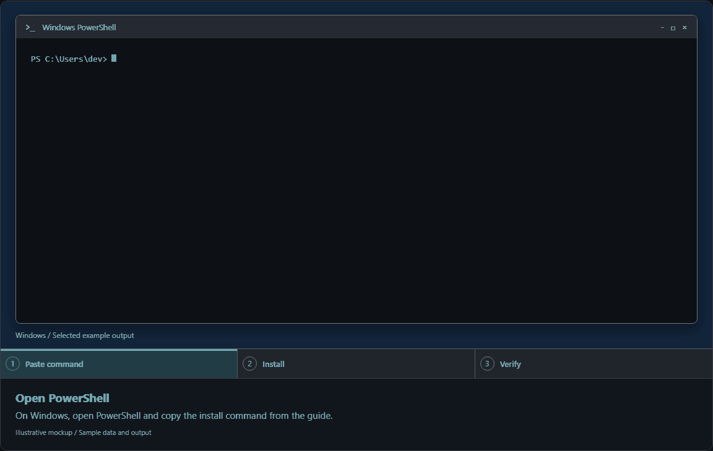
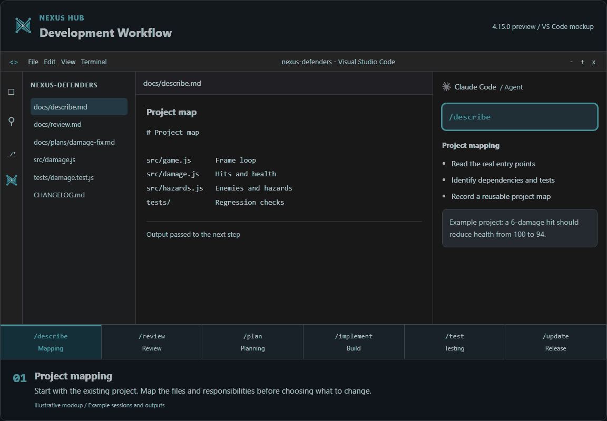
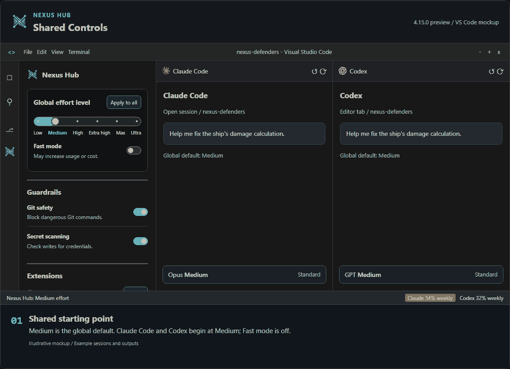
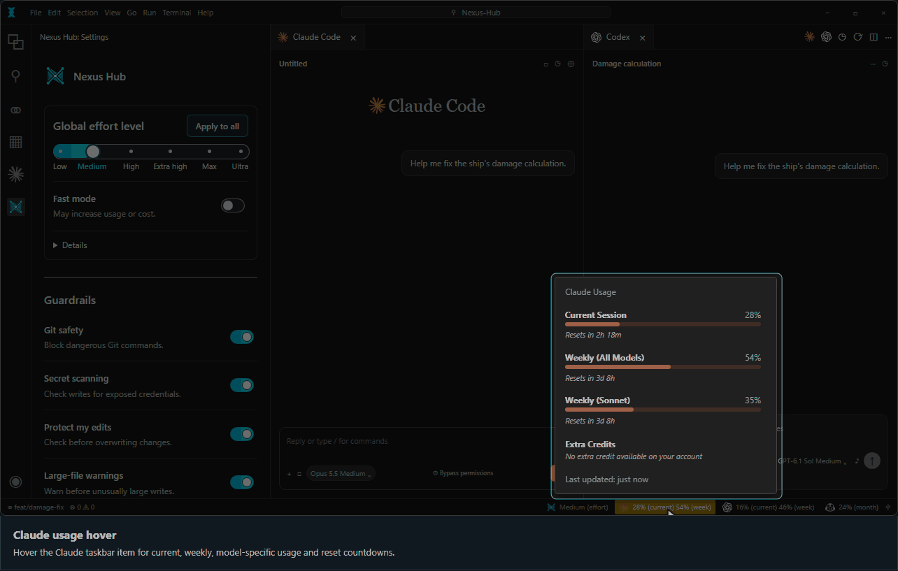
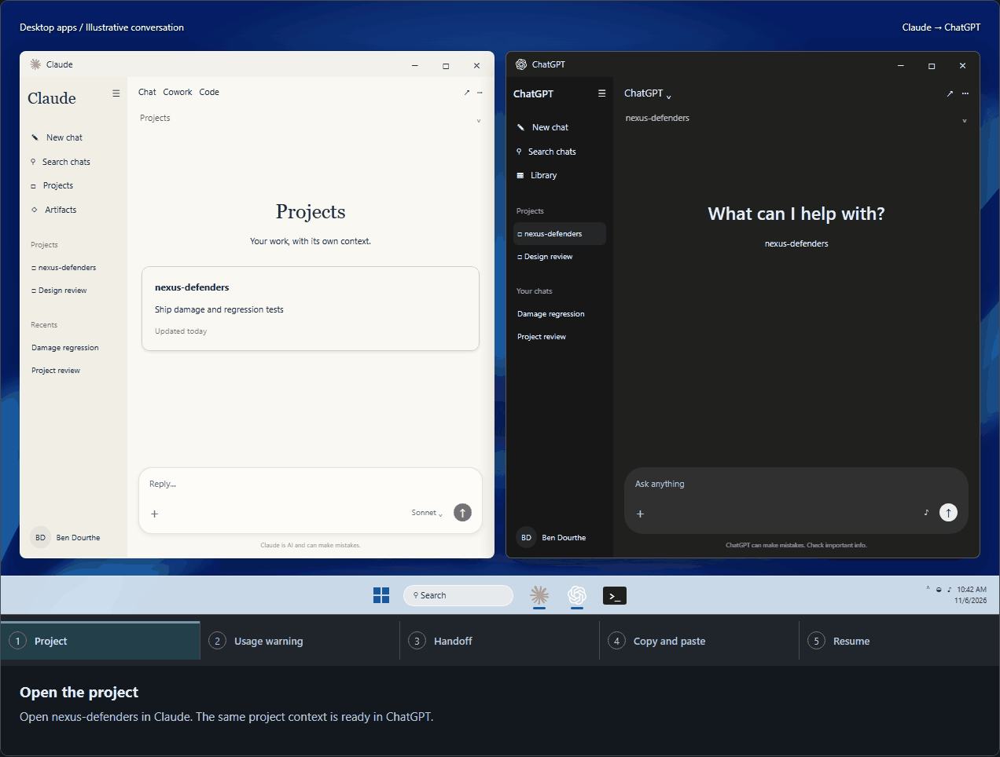
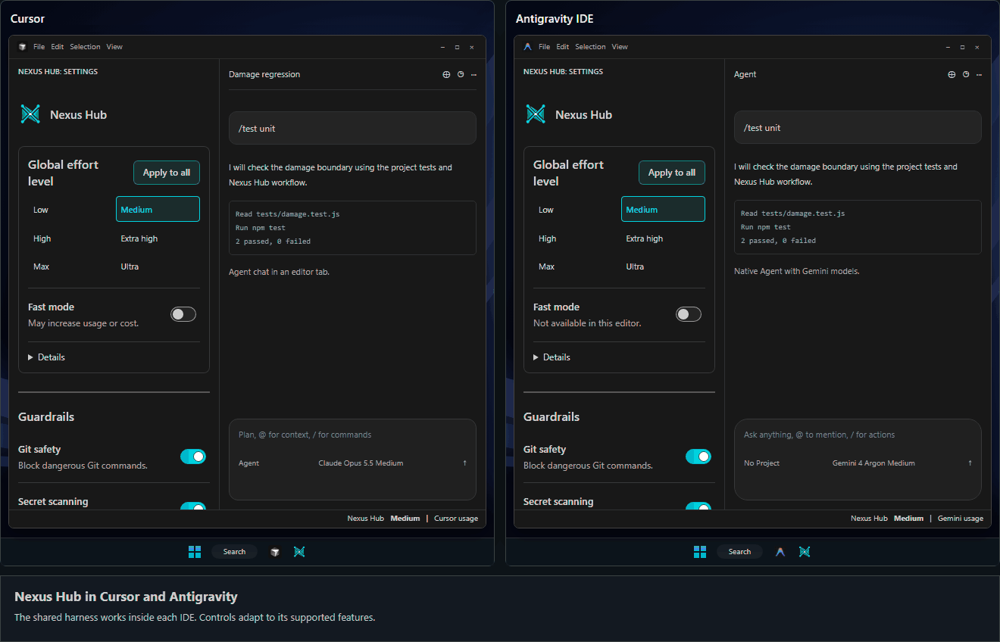

<p align="center"><a href="https://github.com/bendourthe/Nexus-Hub"></a></p>

# Nexus-Hub

Nexus Hub 是面向 AI 编码工具的后端框架：包含技能、命令、规则、钩子、防护机制和最佳实践。安装程序会在你的电脑上配置受支持的平台。代理通过你现有的 IDE、终端或已配置的应用使用这套框架。

**目录：** 340 个技能（23 个类别）、22 个命令（另有 3 个永久别名）、37 个已注册钩子、23 个代理。

[English](README.md) | 中文 | [交互式指南与训练](https://www.benjamindourthe.com/nexus-hub/index.html) | [技能](data/SKILL_INDEX.md) | [命令速查表](#命令速查表) | [平台覆盖](docs/policy/platform-read-contracts.md)

## v4.15.0 更新内容

- 设置中新增使用额度提醒开关，可按服务商分别开关或一次全部开关；使用额度警告会在 10 秒后自动关闭。
- Nexus-Hub Settings 会安装到检测到的每个 VS Code、Cursor 和 Antigravity 编辑器中，并只应用一次共享的推理强度和速度默认值，不会覆盖会话中的选择。
- 修复了 Cursor 和 Gemini 使用额度监视器的问题；逐条审查常驻指令的必要性后，常驻指令更加精简。

[版本详情与早期版本](CHANGELOG.md#4150---2026-11-12)

## 安装

**Windows PowerShell**

```powershell
irm https://raw.githubusercontent.com/bendourthe/Nexus-Hub/main/install.ps1 | iex
```

**macOS / Linux 终端**

```bash
curl -fsSL https://raw.githubusercontent.com/bendourthe/Nexus-Hub/main/install.sh | bash
```

安装程序会检测受支持的工具、复制框架文件并验证安装结果。完成后请重新打开 IDE 或开始新的代理会话。



[静态预览](assets/readme/nexus-hub-installation.png) | [安装选项、更新与验证（英文）](docs/guides/installation-and-platforms.md)

## 开发工作流

| 步骤 | 命令 | 结果 |
| --- | --- | --- |
| 1 | `/describe` | 项目结构图与依赖关系 |
| 2 | `/review` | 按优先级排列的问题 |
| 3 | `/plan` | 分阶段计划与验收检查 |
| 4 | `/implement` | 按计划验证的代码修改 |
| 5 | `/test` | 回归与边界检查 |
| 6 | `/update release` | 版本号、发布说明与发布检查 |



[静态预览](assets/readme/nexus-hub-workflow.png) | [详细工作流（英文）](docs/guides/development-workflows.md)

## 集中式 IDE 设置

| 控制项 | 行为 |
| --- | --- |
| 全局推理强度 | 更新受支持的已打开会话，并设为新会话的默认值 |
| 应用到全部 | 在手动修改某个会话后重新应用默认值 |
| 快速模式 | 更新受支持的提供方；不可用时禁用 |
| 防护机制 | 为受支持的工具调用启用检查 |
| 使用量提醒 | 控制弹出提醒，状态栏颜色保持有效 |
| 扩展 | 适用于 Claude Code 和 Codex 的 VS Code 控制项：恢复、标签页和历史记录 |

手动设置的会话选项会一直保留，直到下一次全局更改或点击 **应用到全部**。



[静态预览](assets/readme/nexus-hub-settings.png) | [扩展控制项（英文）](extensions/nexus-hub-settings/README.md)

## 使用量监控

- **悬停：** 显示使用量条、配额和重置倒计时。
- **点击：** 在编辑器标签页中打开提供方的完整仪表板。
- **提醒：** 一个总开关，另可在 VS Code 中单独控制各个监控器。状态颜色始终有效。



[静态预览](assets/readme/nexus-hub-usage.png) | [交互式演示](guides/website/readme-showcase.html?tour=usage)

## 交接

1. **选择：** 等待重置、交接，或使用额度继续。
2. **转移：** 将生成的续接提示复制到接收方应用中。
3. **继续：** 连同项目文件一起发送，从记录的下一步继续。



请向接收方应用提供相关项目文件。在已安装的代理集成中，`/handoff` 默认在聊天中输出，只有你明确要求时才会写入文件。

[静态预览](assets/readme/nexus-hub-continuity.png) | [交接命令（英文）](catalog/commands/handoff.md)

## 平台

| 平台 | Nexus Hub 集成 |
| --- | --- |
| VS Code：Claude Code | 技能、命令、钩子、共享控制项和 Claude 使用量监控 |
| VS Code：Codex | 技能、命令、钩子、共享控制项、标签页/历史记录和 Codex 使用量监控 |
| VS Code：GitHub Copilot | 受支持的指令和命令，以及 Copilot 使用量监控；推理强度保持原生设置 |
| Cursor | 项目框架、原生 Agent 推理强度/快速模式控制和 Cursor 使用量监控 |
| Antigravity | 项目框架、受支持的 IDE 控制项和 Gemini 使用量监控 |
| Claude 桌面版 | 提供的项目指导和文件、可复用流程以及聊天交接 |
| ChatGPT 桌面版 | 提供的项目指导和文件、可复用流程以及聊天交接 |



[静态预览](assets/readme/nexus-hub-platforms.png) | [交互式平台演示](guides/website/readme-showcase.html?tour=platforms)

终端代理也可使用[受支持的集成（英文）](docs/guides/installation-and-platforms.md#supported-agentic-platforms)。文件访问、权限和钩子覆盖范围取决于宿主平台。项目文件和明确的交接可在不同工具和模型之间延续工作。

## 命令速查表

命令的范围、参数和示例来自 HTML 指南。运行 **`/skills list`** 查看已安装的目录。

### 代码库理解

只读命令。它们会生成报告，但从不修改代码。

#### `/describe`

为任意目录生成结构化描述，无论其是否为软件项目。

| 范围 | 行为 |
| --- | --- |
| `full` | 完整的结构化描述。默认值。 |
| `structure` | 目录布局、模块以及各部分的组织方式。 |
| `deps` | 依赖项、外部服务和版本约束。 |
| `architecture` | 设计、数据流和关键组件，附带图示。 |
| `onboarding` | 快速上手：先读什么、如何运行。 |

```text
/describe full
```

范围后可跟一个目录路径。[在训练中查看](guides/website/training.html#describe)

#### `/review`

可指定范围的只读审查，涵盖所有审查视角。

| 范围 | 行为 |
| --- | --- |
| `full` | 依次运行所有视角，最后给出一个综合结论。 |
| `structure` | 模块边界、分层和依赖关系图。 |
| `quality` | SOLID、复杂度、可维护性和代码异味。 |
| `coverage` | 测试覆盖率分析与缺口识别。 |
| `security` | 密钥、认证、输入验证和危险模式。 |
| `pentest` | 深度渗透测试，附带概念验证结果。 |
| `changes` | 对待提交的差异进行多角色审查，或用 `changes <sha>` 审查单个提交。可将审查意见草稿输出到聊天或指定文件；从不自动发布。 |
| `skill-scan` | 在安装前对某个技能或整个目录进行安全扫描。 |
| `sbom` | 生成软件物料清单（SBOM）。 |
| `deps` | 依赖项 CVE、许可证和供应链扫描。 |

```text
/review changes
```

参数：`--scope <glob>` 和深度参数会原样传递。

[在训练中查看](guides/website/training.html#review)

#### `/compare`

将本项目与外部来源进行比较，生成差距分析和采纳计划。

| 范围 | 行为 |
| --- | --- |
| `repo` | 克隆 Git 仓库，比较结构、依赖和模式。 |
| `article` | 获取网页文章，比较其观点和建议。 |
| `local` | 与磁盘上已有的路径进行比较。 |

```text
/compare ../some-reference-repo
```

范围根据来源自动推断，不会询问。可衔接 `/plan from-comparison`。

---

### 规划与规格

这些命令编写计划、规格和治理原则，即构建命令所读取的产物。

#### `/plan`

为任何多步骤工作定义目标并生成分阶段计划。

| 范围 | 行为 |
| --- | --- |
| `feature` | 为现有项目规划功能或增强。 |
| `goals` | 仅确定问题、用户角色和完成标准。 |
| `new` | 全新的 v0.1.0 构建，包含完整的需求访谈。 |
| `refactor` | 规划重构或清理工作。 |
| `from-comparison` | 基于 /compare 采纳报告生成计划。 |
| `grill` | 对现有计划重新运行批评与追问关卡。 |
| `todos` | 初始化 docs/todos.md 作为持续更新的进度跟踪文件。 |
| `issues` | 将计划中的任务拆分为 GitHub issue。 |

```text
/plan feature
```

`/plan goals <一句话目标>` 可直接接收目标。[在训练中查看](guides/website/training.html#plan)

#### `/spec`

规格与治理工作流。

| 范围 | 行为 |
| --- | --- |
| `clarify` | 通过五个问题的循环消除规格中的歧义。 |
| `analyze` | 跨产物的一致性、覆盖率和歧义审计。 |
| `converge` | 构建后检查代码与计划的差距，并追加剩余工作。 |
| `constitution` | 编写或修订项目的治理原则。 |

```text
/spec clarify
```

#### `/constitution`

编写或修订带版本号的项目章程。

| 范围 | 行为 |
| --- | --- |
| `(bare)` | 编写章程；若已存在则进行修订。 |
| `amend` | 显式修订模式。 |
| `check <path>` | 针对计划或规格进行只读的章程检查。 |

```text
/constitution check
```

---

### 实现

这里是唯一会写入源代码的命令。非最终阶段只在本地提交，从不推送。

#### `/implement`

端到端实现整个计划，或某个次版本中排队的所有计划。一次审批粘贴即可启动运行，并在平台支持时设置原生目标；运行只会因检查器结论、明确的阻碍或暂停而停止。

| 范围 | 行为 |
| --- | --- |
| `<plan>` | 默认运行整个计划：每个阶段，然后发布、发版并清理。可以是 slug、计划文件路径或 vX.Y.Z 版本号。 |
| `vX.Y` | 在一次审批下，按版本顺序运行该次版本中所有排队的计划。 |
| `(bare)` | 运行下一个排队的完整计划。 |
| `<plan> phase <N>` | 单步模式：只运行一个阶段（也可写作 phase-N）。 |
| `<plan> next` | 单步模式：运行第一个未完成的阶段。 |
| `<plan> phase-by-phase` | 单步模式：完整循环，每个阶段后暂停供你选择。 |
| `<plan> full` | 默认行为的别名（也可写作 in-full）。 |
| `pause` | 在下一个安全点暂停当前运行。 |

```text
/implement v0.5
/implement my-plan
```

[在训练中查看](guides/website/training.html#implement)

#### `/route`

评估任务，推荐成本最低且足够胜任的模型和推理强度。

| 范围 | 行为 |
| --- | --- |
| `(bare)` | 评估当前正在进行的任务。 |
| `phase N of <plan>` | 评估计划中的某个阶段。 |
| `"<task text>"` | 直接评估一段带引号的任务描述。 |

```text
/route
```

---

### 测试与审查

#### `/test`

在各测试层级上将覆盖率提升到阈值，直到同时达到该阈值和 100% 通过率。

| 范围 | 行为 |
| --- | --- |
| `all` | 依次处理单元、集成、端到端和 CI，每层都达到阈值。 |
| `unit` | 将单元测试覆盖率提升到阈值。 |
| `integration` | 将集成测试覆盖率提升到阈值。 |
| `e2e` | 将端到端测试覆盖率提升到阈值。 |
| `ci` | 验证流水线会运行测试套件并检查覆盖率。 |
| `tdd` | 针对单个功能或缺陷执行红-绿-重构循环。 |

```text
/test unit
```

参数：`--threshold` 覆盖 80% 的行覆盖率目标；`--pass-rate` 覆盖 100% 的通过率要求。

[在训练中查看](guides/website/training.html#test)

---

### 发布与治理

#### `/update`

查看进度、同步仓库或运行发布流程。

| 范围 | 行为 |
| --- | --- |
| `release` | 完整的发布流程：提交、打标签、推送并发布版本。在次版本系列的最后一次发布后，创建一个收尾拉取请求，然后经检查只清理已合并且空闲的分支和工作树。 |
| `docs` | 同步 README、API 文档、架构文档和内联指南。 |
| `devlog` | 刷新本次发布在 DEVLOG 中的索引行。 |
| `gitignore` | 审计 .gitignore、清理索引并推荐 LFS。 |
| `version` | 在所有位置原子化地更新版本号。 |
| `changelog` | 根据 git 历史重新生成或扩展 CHANGELOG.md。 |
| `refactor` | 按约定重新组织文档和项目产物。 |
| `config` | 验证并修复已安装的平台配置。 |
| `commit` | 为已暂存的更改生成结构化提交信息。 |
| `status` | 只读查看进度、工作进程、已用时间、预估和依赖关系。 |

```text
/update status v0.5
```

[在训练中查看](guides/website/training.html#update)

#### `/grill`

追问计划、设计或决策，直到没有任何未经确认的假设。

```text
/grill
```

#### `/commit`

为已暂存的更改生成结构化提交信息。

```text
/commit
```

#### `/org`

连接、同步、查看或编写组织知识包。

| 范围 | 行为 |
| --- | --- |
| `status` | 查看当前连接状态和各平台情况。 |
| `connect` | 验证并连接一个目录或 git URL。 |
| `sync` | 刷新当前连接的组织来源。 |
| `author` | 通过引导流程构建有效的标准包。 |

```text
/org status
```

---

### 沟通与报告

#### `/presentify`

将文档、代码或整个文件夹转换为一个独立的离线交互式网站。

| 范围 | 行为 |
| --- | --- |
| `deck` | 单个 .pptx：以交互式网站保留原有流程。 |
| `report` | 单个 .docx、.pdf 或 .xlsx，保留结构和图表。 |
| `compile` | 两个或更多文件，或一个文件夹：每个来源都是带标签和出处的独立区域。 |

```text
/presentify ./docs --nav slides
```

模式自动检测，可用 `--mode` 覆盖。设计参数：`--style`、`--theme`、`--layout`、`--nav`（scroll 或 slides）、`--interactivity`、`--images`、`--verbosity`、`--qa-depth`、`--out`。

#### `/research`

多来源研究、报告汇编和文档导出。

| 范围 | 行为 |
| --- | --- |
| `deep` | 并行网络研究，经对抗式验证后附上引用。 |
| `compile` | 将多份报告合并为一份去重后的文档。 |
| `report` | 通过模板将 Markdown 导出为 .docx 或 .pptx。 |

```text
/research deep
```

#### `/visualize`

将数据或描述的结构转换为能回答问题的最简图表或示意图。

| 范围 | 行为 |
| --- | --- |
| `auto` | 根据输入推断使用图表还是示意图。 |
| `chart` | 将数据转换为图表：柱状图、折线图、散点图、分布图。 |
| `diagram` | 流程图、依赖关系图或架构图。 |
| `diff` | 用变更模块图解释一组更改。 |

```text
/visualize data.csv
```

最后会输出一行层级说明，标明所用形式：表格、Mermaid 或离线内联 SVG 页面。从不编造数据，也不访问网络。

---

### 框架与会话管理

#### `/skills`

浏览、搜索、创建、导入和扫描技能与命令目录。

| 范围 | 行为 |
| --- | --- |
| `search` | 按关键词、类别或角色查找技能。 |
| `list` | 列出所有技能和命令的统一速查表。 |
| `create` | 以交互方式创建新的技能或命令。 |
| `import` | 将目录中的技能导入项目，并经过规范检查。 |
| `scan` | 在安装前对某个技能或整个目录进行安全扫描。 |

```text
/skills list
```

#### `/commands`

显示命令速查表，运行时从命令文件中生成。

```text
/commands
```

#### `/session`

管理会话边界：恢复、收尾或写入历史记录。

| 范围 | 行为 |
| --- | --- |
| `continue` | 恢复：之前在做什么、接下来做什么。 |
| `wrap-up` | 会话结束流程：历史记录、清理、文档和提交。 |
| `history` | 生成独立的会话历史文档。 |

```text
/session continue
```

#### `/setup`

初始化项目，或安装可选的提交前审查钩子。

| 范围 | 行为 |
| --- | --- |
| `project` | 初始化指令、项目骨架、.gitignore 和核心文档。 |
| `hooks` | 安装可选的提交前 AI 审查钩子。 |

```text
/setup project
```

#### `/tune-prompting`

更新目录针对每个当前模型的提示方式。

| 范围 | 行为 |
| --- | --- |
| `(bare)` | 对所有需要研究的模型运行完整流程。 |
| `<model-id>` | 仅针对一个模型运行。 |

```text
/tune-prompting --dry-run
```

参数：`--dry-run` 只提出建议而不应用；`--profiles-only` 完全跳过共享正文阶段。

#### `/memory`

审计、精简和重新组织指令文件与记忆文件。

```text
/memory
```

#### `/usage`

查看使用额度，并获得切换模型的建议。

```text
/usage
```

#### `/handoff`

在聊天中输出可直接粘贴的续接提示，让另一个代理继续工作。只有在你要求时才写入文件。

```text
/handoff
```

[交互式速查表](https://www.benjamindourthe.com/nexus-hub/index.html#cheatsheets) | [命令目录](catalog/commands/)

## 文档

以下文档为英文：

- [安装与平台参考](docs/guides/installation-and-platforms.md)
- [开发工作流与本地检查](docs/guides/development-workflows.md)
- [技能目录](data/SKILL_INDEX.md)和[命令目录](catalog/commands/)
- [安全、隐私与受监管场景的注意事项](SECURITY.md)
- [贡献指南](CONTRIBUTING.md)和[项目进度](docs/todos.md)
- [可编辑的动画源文件](assets/readme/README.md)

## 许可证

[MIT](LICENSE)。由 [Benjamin Dourthe](https://www.benjamindourthe.com/) 维护。
