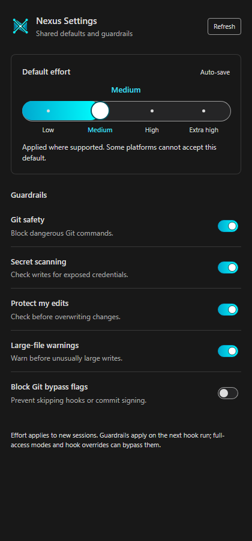
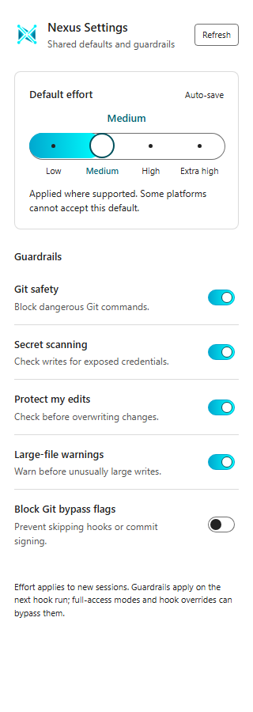

# Settings Effort Controls

The 2026-11-04 follow-up replaces the Settings 0.2.0 effort dropdown with a stepped control, adds compact status labels and effort actions in a multiline hover, and uses the Nexus logo's cyan palette for the effort and guardrail controls. This is bounded local extension work on `feat/settings-redesign-20261104`, based on `1e990035d`; remote publication and release remain separate.

## Behavior

- Compact mode defaults to `High (effort)`; full mode shows `Nexus Settings: High (effort)`. The saved effort supplies the actual value. The existing user's Low preference was preserved.
- `nexusHubSettings.compactStatusBar` controls the prefix and can be toggled from the hover without reloading.
- The native hover separates effort choices, guardrail counts, compatibility details and actions. Its locally generated SVG segments and captions use allowlisted command links. No arbitrary setting value becomes a trusted command.
- The panel uses labeled radio buttons in a rounded cyan track, with one tab stop and Arrow, Home and End handling. Busy states preserve focus and reject repeated writes. Readback confirms the saved value.
- The hover effort command follows the existing settings controller and explicitly refuses writes in untrusted workspaces. Guardrail confirmation behavior is unchanged.
- Unsupported effort platforms retain an informational compatibility note. Conflicts, unreadable defaults and unavailable guardrails still produce the warning marker. The disabled fifth guardrail is a deliberate setting, not the cause of the screenshot's warning.

## Verification

The extension baseline passed 271 tests with one existing skip. The changed extension suite passed 286 tests with one existing skip, and TypeScript compilation passed. The VSIX was built as 0.2.1 and its content verifier passed all 18 required files.

The shipped panel script ran in Chromium against the real settings CLI in a disposable home. Selecting Medium persisted the shared preference and the native Claude and Codex values. Switching the advisory large-file warning off and on changed the actual hook output. Three actions and six captures across dark/light themes at 320, 420 and 900 pixels passed with no browser errors. The visual detector passed at all three widths with zero findings. Contrast checks cover text, focus rings, track edges and thumb outlines; forced-colors system palettes remain outside the modeled contrast ratios.

The packaged extension ran inside real trusted and untrusted VS Code extension hosts. Both exited 0. The compact action changed and restored the effective configuration. The trusted hover command saved Medium and confirmed the model and `Medium (effort)` summary. The untrusted command left the preference file unchanged. The existing isolated editor apply/restore exercise also passed.

The normal extension registry changed from `nexus-hub.nexus-hub-settings@0.2.0` to `nexus-hub.nexus-hub-settings@0.2.1`. A separate normal-profile preview visibly showed `Low (effort)` without a warning, the stepped effort control and cyan switches. That empty preview workspace remained restricted, with disabled write controls. The active chat window was not reloaded, because doing so would interrupt the session.

## Visual Evidence

## Retained Failures

The first changed-suite run failed 13 assertions: twelve contrast assertions still targeted the dropdown or could not parse the new colors, and one notice assertion expected the old compatibility warning. The assertions were updated to measure the new controls, with dark cyan thumb outlines added to distinguish white thumbs from the bright track. The first package attempt failed because its output directory did not exist. It was recreated in the dedicated evidence directory and verified successfully.

The first native run failed an added assertion because the test reused a configuration snapshot after a toggle. The runner now reacquires the configuration for readback; both fresh host runs passed. Startup mutex and built-in API-proposal diagnostics occurred in both failed and passing runs and are not treated as proof of extension failure or success.

## Scope and Remaining Work

The native hover's visual layout could not be captured through the available UI controls. Its Markdown structure and trusted command behavior are tested, but pixel-level parity with the supplied example remains unverified. VS Code's native hover supports images and command links, not a webview form control; the actual stepped radio control is in Settings.

Reload the existing editor window to activate 0.2.1 there. No effort or guardrail preference was changed in the real home. The primary checkout's unrelated `MANIFEST.sha256` edit was preserved. No pipeline file changed and no remote CI was started. No push, merge, tag, release or workspace cleanup was performed. All existing-file edits used clean edit-guard checks; no baseline acceptance was needed.
