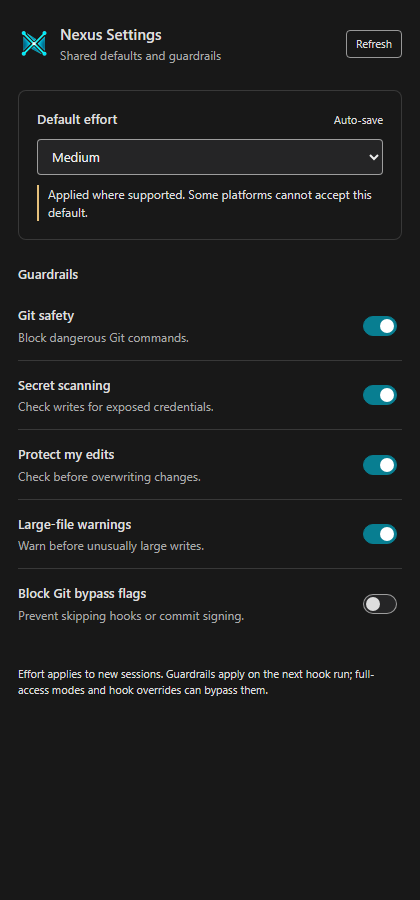
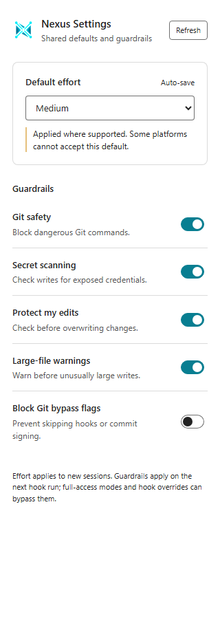

# Settings Redesign Evidence

Settings 0.2.0 replaces the dense platform matrix with one shared effort selector and five functioning guardrail switches. This record covers local implementation, real configuration and hook exercises, package qualification, and installation requested on 2026-11-04. Implementation commit: `b0bc9b762`. The verification/delivery evidence is committed separately. This is not a Nexus-Hub repository release or a completion verdict for the existing v4.15 minor run.

## Completed

- One autosaving effort selector with a persisted shared preference, native writes where admitted, override-aware readback and exact reset.
- Five named switches: Git safety, secret scanning, protection for user edits, large-file warnings and Git bypass-flag protection. Both Bash and PowerShell consumers read the preference on each invocation.
- Compact status bar and short hover; platform/model selectors, diagnostic matrices and scenario previews removed from the main panel.
- Original cyan Nexus PNG on the extension and dashboard, with the same silhouette in theme-colored sidebar and status-bar assets.
- Runtime consumers backed up and installed, followed by the verified 0.2.0 VSIX in the active VS Code profile. Installation preserved all five checked configuration files.

## Functional Exercises

The shipped panel script ran in Chromium with a bridge to the real settings CLI in a disposable home. Changing effort to Medium persisted `default_effort`, synchronized the existing Claude user environment override and native effort settings, and updated the native Codex configuration. Turning large-file warnings off and on changed the output of the actual hook. Three UI actions and six theme/viewport screenshots passed with zero browser errors. The visual-defect detector passed at 320, 420 and 900 pixels with zero findings.

The exact-reset integration regression found a real ownership bug: a conditional effort write did not retain its original JSON member-position hint. The implementation now captures that hint once and retains it across repeated writes and removal. Four new cases failed before the fix and pass afterward. The unchanged real CLI/controller regression now restores the original Claude and Codex files byte for byte after two effort changes, override removal and two resets.

The packaged VSIX installed and opened in real trusted and untrusted VS Code extension hosts. Both reported version 0.2.0, nine diagnostic controls, five available guardrails and the expected trust state. Host startup emitted existing mutex and proposal warnings; both test hosts exited zero, their view-open steps succeeded and their models were ready.

After active-profile delivery, the installed engine read the scratch preference back as Medium. The actual installed Claude PowerShell and Codex Bash Git guards each blocked a dangerous-command payload when configured On and allowed the same payload when configured Off: four expected results passed. No dangerous command was executed; the hooks inspected the payload only.

## Validation

| Scope | Fresh result |
|---|---|
| Settings engine, catalog and installed-layout CLI | 428 passed, 14 skipped |
| Extension | 271 passed, one skipped, 12 test files |
| Extension coverage | 96.79% statements, 88.65% branches, 93.75% functions, 98.41% lines |
| Real hook-switch cases | 124 passed, zero skipped |
| Affected sibling parity and PowerShell syntax | 37 passed |
| Selected existing hook semantics | 48 passed, eight existing jq-dependent variants skipped |
| Final repository fast profile | 18 passed, zero failures or skips |
| Package contents | 18 required files present; 17 installed runtime payloads byte-matched the VSIX, with installed manifest version and registrations checked separately |
| Active runtime delivery | 21 installed engine/hook files hash-matched; five configuration files unchanged |

The original fast run had 17 passes and one personal-path finding in the new plan. The path was corrected, the eight hygiene checks passed, and a fresh complete fast profile then passed all 18 checks. Earlier browser-harness runs exposed a Windows path-visibility issue and an ambiguous locator; the retained final smoke uses a Documents scratch path and the combobox role. These failures were not counted as passes. No repository-wide release/full profile or fresh paid vendor inference session was run.

## Delivery

The active extension registry reports `nexus-hub.nexus-hub-settings@0.2.0`. The package is retained beside the worktree in `../settings-redesign-20261104-artifacts/nexus-hub-settings-0.2.0.vsix`. Runtime backups and the hash receipt are under `~/.nexus-hub/backups/settings-redesign-20261104-0.2.0/`. The receipt covers the five changed settings-engine files and both hook siblings for the four affected hooks in the Claude and Codex directories. User settings, hook registrations and guardrail preferences were not rewritten by installation. Already-open windows require a normal reload to activate the newly installed extension code.

## Architecture Refactor

The existing catalog, writer, ownership, confirmation, trust and readback paths were reused. No new platform control service, pipeline or external dependency was introduced. The old detailed diagnostic model remains available to the CLI and agreement checks; it is not rendered as the main UI.

## Known-Gaps Reconciliation

The effort selector expresses one preference and applies admitted native writes. It cannot invent a vendor control or override a managed policy. Unsupported installed surfaces remain a short attention state. Host full-access modes and hook overrides can bypass configured guards; the footer and hover explicitly distinguish configuration from confirmed enforcement. Instruction-only policies and memory-store protection were not made disableable. Remote publication is outside this local delivery.

## Living Docs Architecture

The extension README, operating guide, shared preference reference and living tracker describe the new behavior. This evidence and its screenshots remain release-scoped. The old historical proof matrix was not edited; new control observations have their own [proof matrix](settings-extension-redesign-proof.md).

## Git-Tree Hygiene

Work used the existing isolated worktree on `feat/settings-redesign-20261104`. The primary checkout's unrelated `MANIFEST.sha256` edit was preserved. Phase 1 ended with local commit `b0bc9b762`; this delivery record and tracker reconciliation form the final local phase commit. No push, merge, tag, release or unrelated cleanup occurred.

## Edit Preservation

Four baseline accepts refreshed only the root agent's own known edits after the edit guard's two-minute recording window expired: `extensions/nexus-hub-settings/README.md`, `guides/NEXUS_HUB_SETTINGS.md`, `settings-extension-redesign-proof.md` and `extensions/nexus-hub-settings/scripts/redesign-smoke.py`. The helper's actual diffs were reviewed; no user edits appeared or were replaced. Subsequent source writes and all installed-file replacements used clean checks, with runtime backups created before replacement.

## CI/CD Coverage

Existing settings, hook, parity and extension selections cover the new behavior. The repository fast profile passed. No pipeline changes were needed or made, and no remote CI run was started.

## Tier 3 Deep Pass

Verdict: run. UI, persistence, hook behavior and distributed assets changed. The pass covered effort persistence, repeated changes and reset, exact-false guard switches, malformed defaults, independent Git bypass protection, workspace trust, busy/focus handling, old-engine placeholders, status-bar text, theme/viewport rendering, packaging and installed delivery. The independent review's guardrail-enforcement wording finding was corrected; no remaining blocking correctness finding was reported.

## Goal-vs-Codebase Review

The new panel has exactly one effort selector and five switches, with no platform-specific selector or model field. Browser actions reached real configuration and a real hook, and native editor hosts loaded the same packaged model. Package and runtime hashes verify that installation delivered the implementation rather than only replacing artwork.

## Human/Manual Testing Suggestions

After reloading an existing VS Code window, open Nexus Settings and confirm the compact layout, original Nexus mark and `Nexus` status label. Effort is a new-session default; protection switches affect subsequent hook runs subject to host mode and overrides. No further user action is needed for installation itself.

## Full-Suite Testing and Stabilization

The complete affected backend and extension suites passed, along with the affected hook selections and fresh repository fast profile. The repository-wide release/full profile was not run because this delivery does not release Nexus-Hub. Unsupported native surfaces and skipped environment variants remain explicit in the validation table.

## Publication and Integration

Local implementation, qualification and active-profile installation are complete. Remote publication, repository integration, release and worktree cleanup are excluded by this delivery's [completion boundary](settings-extension-redesign-plan.md#completion-boundary). No `PLAN COMPLETE` or `MINOR COMPLETE` checker verdict is claimed.
